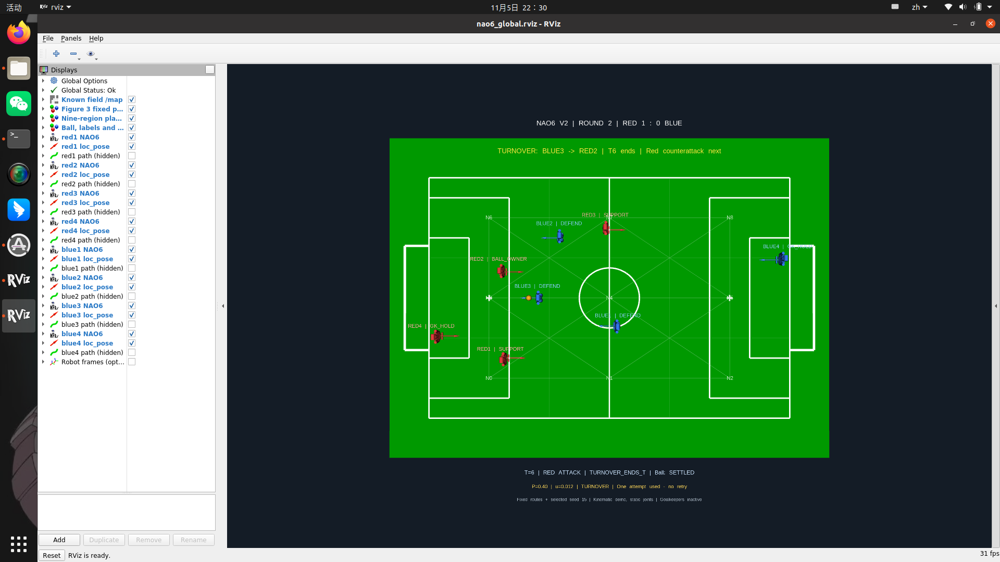

# NAO6 global RViz demo — V2

Both teams move. Red scores in round 1; red wins possession from blue and counterattacks in round 2. A single eligible contest per round uses P = 0.40. Selected seed 15 reproduces the requested story; it is not an unbiased policy comparison.

[Watch/download the recorded replay](evidence/20261105_222716/replay.mp4) · [Detailed technical notes](DETAILS.txt)



## What is demonstrated

- Fixed green/white pitch in the `map` frame, nine high-level regions and eight NAO6 RobotModels.
- Unique `/loc_pose_red1` through `/loc_pose_blue4`, joint topics and robot TF frames.
- Ball settlement, approach, alignment, stop and nominal straight-line kick phases; no separate RECEIVE skill.
- Actual ROS message recording and playback. Path displays remain disabled.

The robots use the selected repository collision-visual V6 URDF with per-robot prefixes and colours.
Root poses are scripted and joint angles remain in an inspection pose. This does **not** validate a
physical walking/kicking controller, real vision, Gazebo contact dynamics or autonomous hardware execution.
The same nominal 2 m kick range remains a calibration assumption.

## Replay the provided recording

Use an Ubuntu 20.04 desktop with ROS Noetic, RViz, robot_state_publisher, tf2_ros and rosbag installed.
Clone/download the whole repository; change the first path if your checkout is elsewhere.

```bash
source /opt/ros/noetic/setup.bash
cd ~/Glasgow-TDP26-NAO6/demos/v2
chmod +x scripts/*.py
gzip -dk evidence/20261105_222716/nao6_global.bag.gz
python3 scripts/show_replay.py evidence/20261105_222716/nao6_global.bag --loop
```

Skip decompression if the `.bag` already exists. Ctrl+C closes playback and its own ROS processes.
The script restores model parameters and starts an isolated ROS master; it refuses an occupied port.
Version 1 uses port 11432 and Version 2 uses 11433. Live state publishers are not started during replay.

## Generate a fresh demonstration

```bash
source /opt/ros/noetic/setup.bash
cd ~/Glasgow-TDP26-NAO6/demos/v2
chmod +x scripts/*.py
python3 -m unittest discover -s tests -v
python3 scripts/run_evidence.py
```

The automatic runner additionally requires `ffmpeg` and `gnome-screenshot`. Its screen capture is configured
for the tested X11 display `:0` at 1920 x 1080 (crop 1848 x 1052 at +72,+28); adjust those settings in
`scripts/run_evidence.py` for another desktop. The portable manual ROS workflow is in [DETAILS.txt](DETAILS.txt).
Direct source-space launch is the supported workflow; a catkin installation is not claimed as tested.

## Files and evidence

| Folder | Contents |
| --- | --- |
| `scripts/` | Scenario, ROS adapter, model preparation, recording/replay and checks |
| `launch/`, `rviz/` | Live/replay launch files and eight-model display |
| `models/`, `urdf/` | Selected source, provenance, licence and eight prefixed models |
| `tests/` | Scenario invariants and regression checks |
| `evidence/20261105_222716/` | Losslessly compressed bag, replay video, screenshots and validation JSON |

The evidence reports describe the original verified Ubuntu run. Repository packaging changes only model-source
path discovery, Python shebangs/line endings and documentation; it does not change the scenario or recordings.
`recording.json` contains the original bag SHA256. A bag stores messages, so keep launch/URDF/RViz files with it.
Machine-specific log files and parameter dumps are excluded; replay.launch restores required robot descriptions.

Original material: [restricted authorised team use](LICENSE.txt). Model derivatives:
[upstream Apache-2.0 terms](models/LICENSE.upstream), with [source provenance](models/source_manifest.json).
