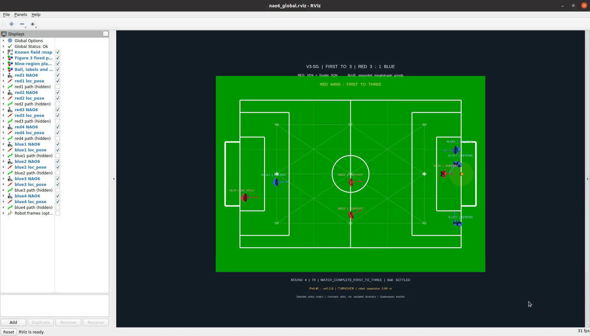

# NAO6 global RViz demo — V4

Red: VDN + Double DQN. Blue: sequential marginal-gain greedy. First to **three** goals wins;
both goalkeepers are fixed and have no effect on the game.

[Watch/download the full recorded replay](evidence/20261110_213922/replay_full_match.mp4) ·
[Method overview and reported results](design/Method_Overview_EN.md) ·
[All six computed routes](design/high_level_routes_EN.txt)



## What this public package contains

This is a **policy-derived match export and ROS demonstration package**. The selected match was computed
in the local football environment before recording. The published executor reproduces its saved actions;
it does not train a model or run new online policy inference. Private research, the GEVD source snapshot,
neural weights, training/optimizer data and reward implementations are not included.

- Eight namespaced NAO6 models, the fixed `map` pitch, nine-region overlay and hidden path displays.
- All six field players moving through bounded kinematic phases with illustrative joint animation.
- Settled-ball approach/alignment, one nominal right-foot kick setting, and explicit skill completion.
- Close contests: P=0.40, both players within 0.50 m of the ball and no more than 0.90 m apart;
  at most one eligible contest per goal round. A turnover ends T before the next owner's action.
- Actual ROS bag recording and independent playback, video and original validation reports.

Selected match: seed **920001**, red/blue score **3:1**, **21** macro decisions;
video duration **361.534 s**. The presentation selector chose the complete match nearest the median length of 24 completed candidates, breaking ties by seed. It did not rank by winner, score margin or contest outcome.

The existing recording was made before the V4 naming change and still displays **V3-SG**. Its filename and content are preserved; the current source publishes **V4**. This is the same validated improvement, not a different policy or a re-edited result.

The common execution is **kinematic animation**, not validated Gazebo contact dynamics, balanced NAO
walking/kicking, real vision or autonomous hardware control. A physical kick still needs calibration.

## Replay the provided recording

Use an Ubuntu 20.04 desktop with ROS Noetic, RViz, `robot_state_publisher`, `tf2_ros`, `rosbag`
and Python 3 NumPy. Clone/download the **whole repository**, including every compressed bag part.

```bash
source /opt/ros/noetic/setup.bash
cd ~/Glasgow-TDP26-NAO6/demos/v4
chmod +x scripts/*.py
python3 scripts/prepare_recording.py
python3 scripts/show_replay.py evidence/20261110_213922/nao6_v3_sgre_first_to_three.bag --loop
```

The restore script verifies every part, joins and decompresses the gzip stream, then checks the original
bag SHA256. It refuses to overwrite a different existing bag. No training or private repository is needed.
Ctrl+C closes playback and its own ROS processes. This edition uses isolated port **11437** and refuses
an occupied port. It restores model parameters without starting live movement publishers.

## Execute the exported plan and make a fresh recording

```bash
source /opt/ros/noetic/setup.bash
cd ~/Glasgow-TDP26-NAO6/demos/v4
chmod +x scripts/*.py
python3 -m unittest discover -s tests -v
python3 scripts/run_evidence.py
```

This executes the already selected plan, records actual messages with `rosbag record -a --lz4`, stops
live publishers, then runs `rosbag play --clock`, verifies message/TF playback and films RViz.
New output goes to a fresh timestamped directory; the supplied evidence is not overwritten.
It additionally needs `ffmpeg` and `gnome-screenshot`. The tested X11 desktop is `:0`, 1920×1080,
with a video crop of 1848×1052 at +72,+28; adjust screen capture for another desktop.
`run_evidence.py` restores URDF parameters and separately saves fresh parameter dumps locally.
Those machine-specific dumps/logs should not automatically be committed.

For live display only, after the setup commands above:

```bash
export DISPLAY=:0 XAUTHORITY="$HOME/.Xauthority" DISABLE_ROS1_EOL_WARNINGS=1
export ROS_HOSTNAME=127.0.0.1 ROS_MASTER_URI=http://127.0.0.1:11437
unset ROS_IP
export ROS_PACKAGE_PATH="$(dirname "$PWD"):$ROS_PACKAGE_PATH"
roslaunch --port 11437 eng5325_global_demo_v4 live.launch
```

Source-space execution is supported. A catkin install-space workflow is not claimed as tested.

## Files and evidence

| Folder | Contents |
| --- | --- |
| `scripts/` | Portable geometry, fixed-plan executor, animation, ROS adapters, recording/replay and checks |
| `plans/demo_plan.json` | Selected actions, physical events and recorded decision telemetry; no trained weights |
| `launch/`, `rviz/`, `models/`, `urdf/` | Matching models, configuration and upstream provenance |
| `tests/` | Export continuity, first-to-three, keeper, contest and graph checks |
| `design/` | Method-level explanation, reported results and selected high-level routes |
| `evidence/20261110_213922/` | Lossless bag parts, unchanged video, inspected frames and original verification JSON |
| `publication_validation.json` | Packaging checks and comparison with the local execution timeline |
| `publication_runtime.json` | Public-package startup and replay checks on Ubuntu 20.04 / ROS Noetic |

The bag preserves actual recorded topics, including decision telemetry. The separate machine logs,
parameter dumps, original runtime archive and private model/config/training files are not published.
Original verification reports refer to the source recording; packaging checks are labelled separately.
`recording.json` gives the original bag/video hashes and compressed-part hashes. Keep the matching
launch/URDF/RViz files: a bag is not an automatic backup of ROS parameters or a Gazebo physics replay.

Original course material: [restricted authorised team use](LICENSE.txt).
Model derivatives retain [upstream Apache-2.0 terms](models/LICENSE.upstream) and
[source provenance](models/source_manifest.json).
